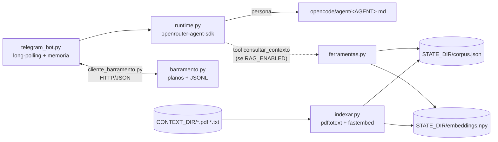

# AGENTS.md

Telegram bot that chats **in character as a persona**, in pt-BR, optionally grounded
in a document context via RAG. **One persona per instance** — the code is generic and
single-persona; multiplicities (Bukowski, Buda, Ramanujan, Pessoa, …) are a deployment concern handled by
`docker-compose.yml`. There is **no test suite, linter or build step** — verification is
running the pieces directly.

## Architecture



`config.py` reads all settings from the environment (`AGENT`, `RAG_ENABLED`, …). The
persona `.md` is shared: `runtime.py` reads it for the native bot and the opencode TUI
can drive it interactively. `runtime.py` strips a leading `openrouter/` from the `model:`
frontmatter and injects a non-interactive output contract at call time.

## Configuration (environment)

| Var | Meaning | Default |
|---|---|---|
| `AGENT` | loads `.opencode/agent/<AGENT>.md`; sets the logger name | `bukowski` |
| `RAG_ENABLED` | `true` registers the `consultar_contexto` tool | `false` |
| `CONTEXT_DIR` | PDFs/TXTs to index | `contexto/<AGENT>` |
| `STATE_DIR` | corpus/embeddings/sessions | `data/<AGENT>` |
| `RETRIEVAL` | `hybrid` \| `bm25` | `hybrid` |
| `EMBED_MODEL` | fastembed model | `.../paraphrase-multilingual-MiniLM-L12-v2` |
| `OPENROUTER_MODEL` / `OPENROUTER_MODEL_<AGENT>` | model override | persona frontmatter |
| `MAX_HISTORY` | messages kept per chat | `12` |
| `INDEX_ON_START` | index at container start if missing | `true` |
| `TELEGRAM_BOT_TOKEN`, `TELEGRAM_ALLOWED_USER_IDS` | secret (env_file) | — |
| `OPENROUTER_API_KEY` | secret (`.secrets/openrouter.env`) | — |
| `FASTEMBED_CACHE_PATH` | model cache dir (mounted volume) | fastembed's default |
| `BARRAMENTO_ENABLED` | liga a ponte HTTP no bot | `false` |
| `BARRAMENTO_URL` | hub na rede Docker | `http://barramento:8080` |
| `BARRAMENTO_POLL_TIMEOUT` | long-poll do cliente | `25` |
| `BARRAMENTO_PORTA` | porta do hub | `8080` |
| `BARRAMENTO_STATE` | JSONL do hub | `/app/.state/eventos.jsonl` |
| `BARRAMENTO_TOKEN` | segredo compartilhado (`.secrets/barramento.env`) | — |
| `BARRAMENTO_CHAT_IDS` | grupos coordenados pela ponte | — |
| `BARRAMENTO_BOTS` / `BARRAMENTO_ORDEM` | bots do hub / ordem de início | `pessoa,bukowski` |
| `BARRAMENTO_TIMEOUT` | timeout por convite | `60` |
| `BARRAMENTO_MAX_MENSAGENS` | teto de mensagens por plano | `12` |
| `BARRAMENTO_RODADAS_PADRAO` | rodadas sem pedido explícito | `1` |

## Comunicação entre personas (ponte)

Bots do Telegram não recebem mensagens de outros bots. Para eles conversarem no
mesmo grupo, um serviço interno (`barramento`, HTTP/JSON) coordena os turnos:

- O bot publica a mensagem humana em `POST /eventos`; o hub deduplica e cria um
  plano. Em chats de `BARRAMENTO_CHAT_IDS`, o bot **não** responde direto.
- O hub convida **um bot por vez** via long-poll (`GET /eventos`); o bot responde
  no Telegram e publica a fala. O hub então convida o próximo.
- Padrão: 1 rodada (cada participante fala uma vez). `3 rodadas` com 2 bots = 6
  mensagens. Um único bot mencionado responde sozinho (1 mensagem); os outros
  ficam calados. Sem menção e sem pedido explícito (`Oi`), também é 1 rodada com
  todos os bots do hub (2 mensagens com 2 bots).
- Se só um participante for mencionado, `N rodadas` continua valendo 1 mensagem:
  sem interlocutor, não há rodízio.
- Uma nova mensagem humana durante um plano cancela o plano anterior; timeout de
  convite encerra o plano.
- `barramento.py` é o hub (parser dos pedidos, planos, timeout, `eventos.jsonl`);
  `cliente_barramento.py` é o cliente usado por `telegram_bot.py`.
- A rede `agentes` é interna (`internal: true`); o hub não tem acesso à internet
  nem porta publicada. Bots ficam nas redes `default` + `agentes`.
- O log `data/barramento/eventos.jsonl` é append-only (uma linha JSON por evento) e
  serve para auditoria/replay manual; planos ativos vivem em memória.
- Sem `BARRAMENTO_ENABLED`, o bot funciona como antes (resposta direta). Se o hub
  estiver fora do ar, o bot cai no modo direto.

## Layout

```
.opencode/agent/<persona>.md     persona (source of truth); `bot_name:` optional
contexto/<persona>/*.pdf|*.txt    context (optional); `titulos.json` maps file -> title
.secrets/openrouter.env          shared OpenRouter key
.secrets/<persona>/telegram.env  one bot/token per persona
.secrets/barramento.env          shared token for the internal hub
data/<persona>/                  STATE_DIR (sessions, corpus, embeddings)
data/barramento/eventos.jsonl    JSONL log of the inter-agent hub
```

`contexto/` is gitignored, so a persona's `titulos.json` is **local only** — recreate it
per host (it is not versioned). `data/<persona>/bot.log` only exists on the host (written
by `run_bot.sh`'s redirect); in Docker the logs go to `docker logs`.

## Core scripts

Everything is Python in the repo root. Host runs use the dedicated venv:
`./.venv/bin/python <script>`.

- `config.py` — env parsing; loads `.secrets/openrouter.env` at import.
- `telegram_bot.py` — long-poll loop; `/start` `/help` `/limpar` `/id` (user id e chat id)
  e `/contexto` (só quando `RAG_ENABLED`); per-chat history in `STATE_DIR/sessions.json`.
- `runtime.py` — `responder(mensagem, historico, instrucao_extra=None)`; registra
  `consultar_contexto` só quando `RAG_ENABLED`.
- `ferramentas.py` — `consultar_contexto` (the only tool); `buscar_hibrido()` = BM25 +
  cosine over local `fastembed` embeddings, fused by RRF; falls back to BM25 if vectors
  are missing. `RETRIEVAL=bm25` skips vectors. Also `tokenize`/`limpar_texto`.
- `indexar.py` — PDFs via `pdftotext -layout` (ou `.txt` direto) → clean → chunk (~900 chars)
  → `STATE_DIR/corpus.json` + `STATE_DIR/embeddings.npy` + `index_meta.json`. **Re-run after
  adding/changing files.** Titles come from `CONTEXT_DIR/titulos.json` (optional), else the
  filename.
- `coletar_arquivo_pessoa.py` — coletor/curador do Arquivo Pessoa (host, opcional): gera
  `contexto/pessoa/*.txt` + `titulos.json` + `manifesto.json` a partir de
  `http://arquivopessoa.net/`. Cache de HTML em `data/pessoa/cache_html`.
- `barramento.py` — hub HTTP/JSON da ponte entre personas: parser de pedidos
  (`Pessoa e Bukowski interajam ... em 3 rodadas`), planos, convites, timeout e
  log JSONL. Roda como serviço `barramento` na rede interna.
- `cliente_barramento.py` — cliente da ponte: publica mensagem humana/fala e consome convites
  via long-poll; cursor em `STATE_DIR/barramento_cursor.json`.
- `logsetup.py` — stdlib logging to **stdout/stderr** (visible in `docker logs`); on the
  host `run_bot.sh` redirects it to `STATE_DIR/bot.log`. Logger `<AGENT>.*`.

## Host operation

- deps: `./.venv/bin/pip install -r requirements-bot.txt`. **The pins matter** — newer
  `openrouter` breaks `openrouter-agent-sdk` (`openrouter==1.1.0`,
  `openrouter-agent-sdk==0.8.0`). `fastembed` pulls ONNX (no torch).
- Start: `nohup ./run_bot.sh >/dev/null 2>&1 </dev/null &` (defaults `AGENT=bukowski`,
  `RAG_ENABLED=true`, `STATE_DIR=data/<AGENT>`, `CONTEXT_DIR=contexto/<AGENT>`).
- Stop: `kill "$(cat data/<AGENT>/bot.pid)"` (up to ~25 s; `kill -9` if needed).
  **Never run two instances with the same token** — Telegram returns `409 Conflict`.
- Secrets: copy `.secrets/openrouter.env.example` → `.secrets/openrouter.env` and
  `.secrets/telegram.env.example` → `.secrets/<persona>/telegram.env`; `chmod 600`.
- Ponte: pensada para Docker (`barramento` + rede `agentes`). No host, rode
  `barramento.py` em um terminal e exporte `BARRAMENTO_*` nos bots; sem o hub,
  a resposta é direta.

## Docker (one container per persona)

- `Dockerfile` — `python:3.12-slim` + `poppler-utils`; installs `requirements-bot.txt`;
  `ENTRYPOINT` = `docker-entrypoint.sh`.
- `docker-entrypoint.sh` — if `RAG_ENABLED=true`, `INDEX_ON_START=true` and
  `/app/.state/corpus.json` is missing, runs `indexar.py`, then `exec`s the bot (PID 1).
- `docker-compose.yml` — `x-persona` anchor; one service per persona. Non-secret config
  in `environment`, secrets via `env_file` (shared `./.secrets/openrouter.env`,
  per-persona `telegram.env` e `barramento.env` nos bots da ponte), content/state via
  volumes. `model-cache` is a shared named volume (`FASTEMBED_CACHE_PATH=/models`) so the
  embedding model downloads once.
- `barramento` — the inter-agent hub (same image, `entrypoint` = `barramento.py`), on the
  internal `agentes` network, with `./data/barramento` for the JSONL log. Bots da ponte
  também entram em `agentes`; the hub has no published ports and no internet.
- First launch of a RAG persona downloads the embedding model (~0.2 GB) and indexes the
  context; later starts reuse `data/<persona>` and the cache.

## Verification (no test suite)

```bash
# persona only (no RAG)
RAG_ENABLED=false AGENT=buda ./.venv/bin/python runtime.py "Mestre, estou ansioso."

# RAG on
AGENT=bukowski STATE_DIR=data/bukowski CONTEXT_DIR=contexto/bukowski ./.venv/bin/python indexar.py
AGENT=bukowski STATE_DIR=data/bukowski ./.venv/bin/python ferramentas.py "corrida de cavalos"

# Docker
docker compose build
docker compose up -d
docker compose ps && docker compose logs -f bukowski
# Ponte entre agentes
docker compose logs -f barramento
tail -f data/barramento/eventos.jsonl
```

`ferramentas.consultar_contexto` and `runtime.responder` log to stdout; in Docker check
`docker logs -f <container>` (host: `STATE_DIR/bot.log`). Confirm the model actually
invoked the tool (`call_model ... tools=1`).

## Notes

- `.gitignore` excludes `data/`, `.venv/`, `.secrets/*` (only `*.example` kept),
  `__pycache__/`, `contexto/`, `.env`.
- The `contexto/` PDFs/TXTs are (often) copyrighted — **never version them**, nor a prebuilt
  `corpus.json`/`embeddings.npy` (they contain verbatim excerpts).
- Keep `.secrets/`, `data/`, `.venv/` out of version control; never commit the
  API key or bot tokens.
