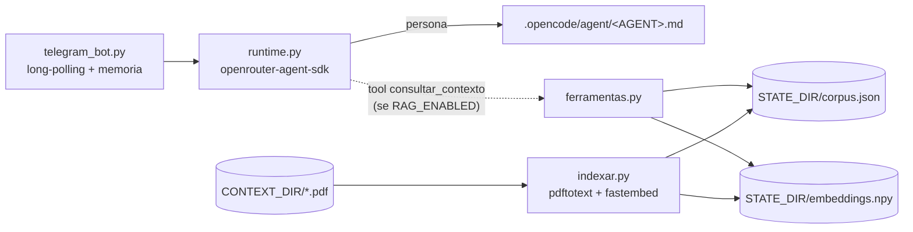

# AGENTS.md

Telegram bot that chats **in character as a persona**, in pt-BR, optionally grounded
in a document context via RAG. **One persona per instance** — the code is generic and
single-persona; multiplicities (Bukowski, Buda, …) are a deployment concern handled by
`docker-compose.yml`. There is **no test suite, linter or build step** — verification is
running the pieces directly.

## Architecture



`config.py` reads all settings from the environment (`AGENT`, `RAG_ENABLED`, …). The
persona `.md` is shared: `runtime.py` reads it for the native bot and the opencode TUI
can drive it interactively. `runtime.py` strips a leading `openrouter/` from the `model:`
frontmatter and injects a non-interactive output contract at call time.

## Configuration (environment)

| Var | Meaning | Default |
|---|---|---|
| `AGENT` | loads `.opencode/agent/<AGENT>.md`; sets the logger name | `bukowski` |
| `RAG_ENABLED` | `true` registers the `consultar_contexto` tool | `false` |
| `CONTEXT_DIR` | PDFs to index | `contexto/<AGENT>` |
| `STATE_DIR` | corpus/embeddings/sessions | `data/<AGENT>` |
| `RETRIEVAL` | `hybrid` \| `bm25` | `hybrid` |
| `EMBED_MODEL` | fastembed model | `.../paraphrase-multilingual-MiniLM-L12-v2` |
| `OPENROUTER_MODEL` / `OPENROUTER_MODEL_<AGENT>` | model override | persona frontmatter |
| `MAX_HISTORY` | turns kept per chat | `12` |
| `INDEX_ON_START` | index at container start if missing | `true` |
| `TELEGRAM_BOT_TOKEN`, `TELEGRAM_ALLOWED_USER_IDS` | secret (env_file) | — |
| `OPENROUTER_API_KEY` | secret (`.secrets/openrouter.env`) | — |
| `FASTEMBED_CACHE_PATH` | model cache dir (mounted volume) | fastembed's default |

## Layout

```
.opencode/agent/<persona>.md     persona (source of truth); `bot_name:` optional
contexto/<persona>/*.pdf         context (optional); `titulos.json` maps file -> title
.secrets/openrouter.env          shared OpenRouter key
.secrets/<persona>/telegram.env  one bot/token per persona
data/<persona>/                  STATE_DIR (sessions, log, corpus, embeddings)
```

## Core scripts

Everything is Python in the repo root. Host runs use the dedicated venv:
`./.venv/bin/python <script>`.

- `config.py` — env parsing; loads `.secrets/openrouter.env` at import.
- `telegram_bot.py` — long-poll loop; `/start` `/help` `/limpar` `/id` and `/contexto`
  (only when `RAG_ENABLED`); per-chat history in `STATE_DIR/sessions.json`.
- `runtime.py` — `responder(mensagem, historico)`; registers `consultar_contexto` only
  when `RAG_ENABLED`.
- `ferramentas.py` — `consultar_contexto` (the only tool); `buscar_hibrido()` = BM25 +
  cosine over local `fastembed` embeddings, fused by RRF; falls back to BM25 if vectors
  are missing. `RETRIEVAL=bm25` skips vectors. Also `tokenize`/`limpar_texto`.
- `indexar.py` — `pdftotext -layout` → clean → chunk (~900 chars) → `STATE_DIR/corpus.json`
  + `STATE_DIR/embeddings.npy` + `index_meta.json`. **Re-run after adding/changing PDFs.**
  Titles come from `CONTEXT_DIR/titulos.json` (optional), else the filename.
- `logsetup.py` — stdlib logging to **stdout/stderr** (visible in `docker logs`); on the
  host `run_bot.sh` redirects it to `STATE_DIR/bot.log`. Logger `<AGENT>.*`.

## Host operation

- deps: `./.venv/bin/pip install -r requirements-bot.txt`. **The pins matter** — newer
  `openrouter` breaks `openrouter-agent-sdk` (`openrouter==1.1.0`,
  `openrouter-agent-sdk==0.8.0`). `fastembed` pulls ONNX (no torch).
- Start: `nohup ./run_bot.sh >/dev/null 2>&1 </dev/null &` (defaults `AGENT=bukowski`,
  `RAG_ENABLED=true`, `STATE_DIR=data/<AGENT>`, `CONTEXT_DIR=contexto/<AGENT>`).
- Stop: `kill "$(cat data/<AGENT>/bot.pid)"` (up to ~25 s; `kill -9` if needed).
  **Never run two instances with the same token** — Telegram returns `409 Conflict`.
- Secrets: copy `.secrets/openrouter.env.example` → `.secrets/openrouter.env` and
  `.secrets/telegram.env.example` → `.secrets/<persona>/telegram.env`; `chmod 600`.

## Docker (one container per persona)

- `Dockerfile` — `python:3.12-slim` + `poppler-utils`; installs `requirements-bot.txt`;
  `ENTRYPOINT` = `docker-entrypoint.sh`.
- `docker-entrypoint.sh` — if `RAG_ENABLED=true`, `INDEX_ON_START=true` and
  `/app/.state/corpus.json` is missing, runs `indexar.py`, then `exec`s the bot (PID 1).
- `docker-compose.yml` — `x-persona` anchor; one service per persona. Non-secret config
  in `environment`, secrets via `env_file` (shared `./.secrets/openrouter.env` +
  per-persona `telegram.env`), content/state via volumes. `model-cache` is a shared
  named volume (`FASTEMBED_CACHE_PATH=/models`) so the embedding model downloads once.
- First launch of a RAG persona downloads the embedding model (~0.2 GB) and indexes the
  context; later starts reuse `data/<persona>` and the cache.

## Verification (no test suite)

```bash
# persona only (no RAG)
RAG_ENABLED=false AGENT=buda ./.venv/bin/python runtime.py "Mestre, estou ansioso."

# RAG on
AGENT=bukowski STATE_DIR=data/bukowski CONTEXT_DIR=contexto/bukowski ./.venv/bin/python indexar.py
AGENT=bukowski STATE_DIR=data/bukowski ./.venv/bin/python ferramentas.py "corrida de cavalos"

# Docker
docker compose build
docker compose up -d
docker compose ps && docker compose logs -f bukowski
```

`ferramentas.consultar_contexto` and `runtime.responder` log to stdout; in Docker check
`docker logs -f <container>` (host: `STATE_DIR/bot.log`). Confirm the model actually
invoked the tool (`call_model ... tools=1`).

## Notes

- `.gitignore` excludes `data/`, `.venv/`, `.secrets/*` (only `*.example` kept),
  `__pycache__/`, `contexto/`, `.env`.
- The `contexto/*.pdf` are (often) copyrighted — **never version them**, nor a prebuilt
  `corpus.json`/`embeddings.npy` (they contain verbatim excerpts).
- Keep `.secrets/`, `data/`, `.venv/` out of version control; never commit the
  API key or bot tokens.
