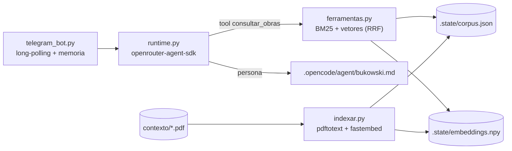

# AGENTS.md

Telegram bot that chats **in character as Charles Bukowski**, in pt-BR, grounded
in two novels via RAG. Native (host, no Docker, no opencode at runtime). There is
**no test suite, linter or build step** — verification is running the pieces
directly.

## Architecture



The `.opencode/agent/bukowski.md` persona is shared: `runtime.py` reads it for the
native bot, and the opencode TUI can drive it interactively. `runtime.py` strips a
leading `openrouter/` from the `model:` frontmatter and injects a non-interactive
output contract at call time. Restart opencode after editing the persona.

## Core scripts

There is **no entrypoint wrapper** beyond `run_bot.sh`; everything is Python in the
repo root. Always use the dedicated venv: `./.venv/bin/python <script>`.

- `telegram_bot.py` — long-poll loop; per-chat history in `.state/sessions.json`;
  commands `/start` `/help` `/limpar` `/obras` `/id`. Runs LLM calls in worker
  threads; ignores non-text updates.
- `runtime.py` — `responder(mensagem, historico)`; loads `.secrets/openrouter.env`
  at import. Model: frontmatter `model:` or `OPENROUTER_MODEL_BUKOWSKI`
  (default `deepseek/deepseek-v4.1-flash`).
- `ferramentas.py` — `consultar_obras(consulta, limite)`; only tool the agent has.
  `buscar_hibrido()` combines BM25 (pure Python) with cosine similarity over local
  `fastembed` embeddings, fused by RRF; falls back to BM25 alone if the vectors are
  missing. Also exposes `tokenize`/`limpar_texto` reused by `indexar.py`.
- `indexar.py` — extracts `contexto/*.pdf` with `pdftotext -layout`, cleans
  boilerplate, chunks (~900 chars), writes the BM25 index `.state/corpus.json`
  (~3 MB) **and** the local embeddings `.state/embeddings.npy` + `.state/index_meta.json`
  via `fastembed` (ONNX, no torch). **Re-run after adding/changing PDFs.** The first
  run downloads the embedding model (~0.2 GB); missing `pdftotext` (poppler-utils)
  or a failed model download leaves the BM25 index usable.
- `logsetup.py` — stdlib logging to a single `.state/bot.log`, logger `bukowski.*`.
- `run_bot.sh` — sources `.secrets/telegram.env` + `.secrets/openrouter.env`,
  writes `.state/bot.pid`, execs `.venv/bin/python telegram_bot.py`. `setsid`-detaches.

## Setup & operation

- deps: `./.venv/bin/pip install -r requirements-bot.txt`. **The pins matter** —
  newer `openrouter` breaks `openrouter-agent-sdk` (`openrouter==1.1.0`,
  `openrouter-agent-sdk==0.8.0`). `fastembed` pulls ONNX (no torch).
- Embedding model: `sentence-transformers/paraphrase-multilingual-MiniLM-L12-v2`
  (384d, pt-BR), override via `BUKOWSKI_EMBED_MODEL`. `e5` models get the
  `query:`/`passage:` prefixes automatically; this MiniLM does not need them.
- Start: `nohup ./run_bot.sh >/dev/null 2>&1 </dev/null &`
- Stop: `kill "$(cat .state/bot.pid)"` (up to ~25 s while the long-poll returns;
  `kill -9` if needed). **Never run two instances** — Telegram returns `409 Conflict`.
- Secrets: copy `.secrets/openrouter.env.example` → `openrouter.env`
  (`OPENROUTER_API_KEY`) and `.secrets/telegram.env.example` → `telegram.env`
  (`TELEGRAM_BOT_TOKEN`, optional `TELEGRAM_ALLOWED_USER_IDS`; empty = everyone).
  `chmod 600`; never commit.

## Verification (no test suite)

Run these by hand after changes; each must print sensible output:

```bash
./.venv/bin/python indexar.py                                  # rebuild corpus
./.venv/bin/python ferramentas.py corrida de cavalos           # RAG query -> trechos
./.venv/bin/python runtime.py "E aí, velho. O que você faria?" # persona + tool call
./.venv/bin/python -c "import runtime; print(runtime.model_for('bukowski'))"
```

`ferramentas.consultar_obras` and `runtime.responder` log to `.state/bot.log`; check
it to confirm the model actually invoked the tool (`call_model ... tools=1`).

## Notes

- `.gitignore` excludes `.state/`, `.venv/`, `.secrets/*` (only `*.example` kept),
  `__pycache__/`, `contexto/`. The `contexto/*.pdf` are copyrighted novels — **never
  version them** (nor a prebuilt `.state/corpus.json`, which contains verbatim excerpts).
- Keep `.secrets/`, `.state/`, `.venv/` out of version control; never commit the API
  key or bot token.
